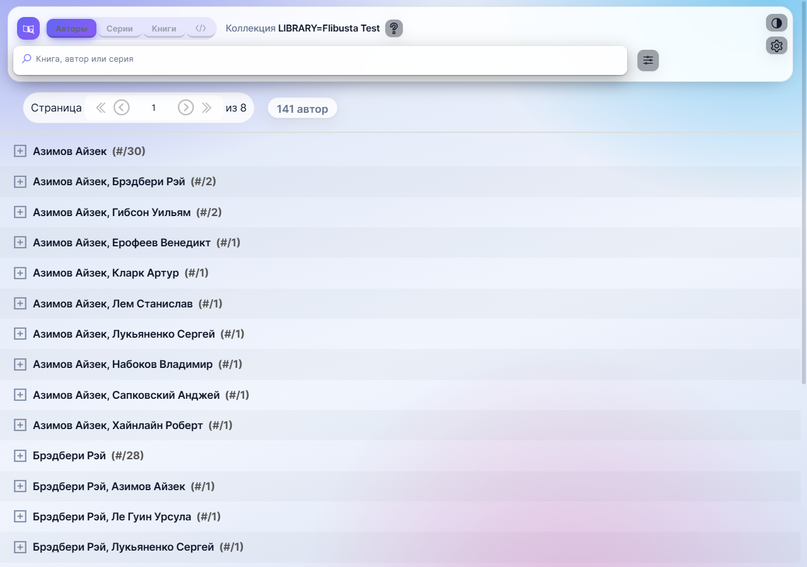
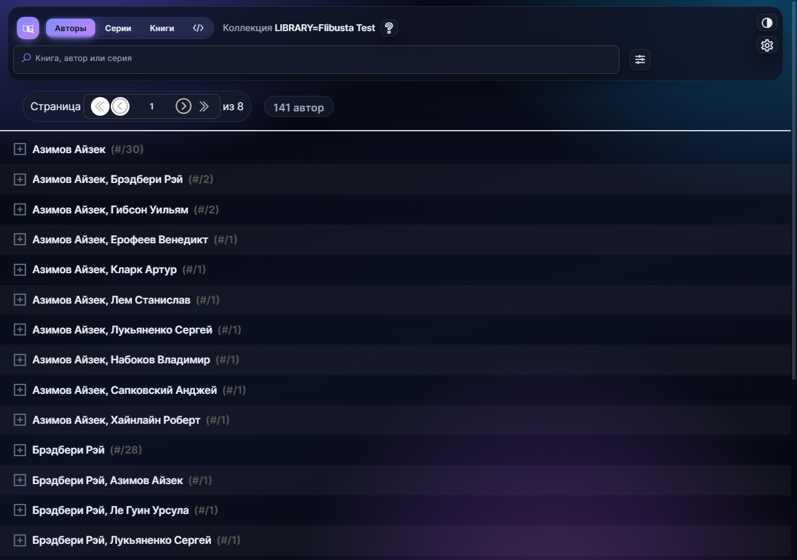

# inpx-web · glass theme

Форк [inpx-web](https://github.com/bookpauk/inpx-web) (через
[drts-sv/inpx-web](https://github.com/drts-sv/inpx-web)) с современным
оформлением: светлая и тёмная темы, стеклянные панели, мобильная вёрстка для
использования из приложения Home Assistant.

Функциональность апстрима сохранена полностью: поиск по автору/серии/названию/
языку/жанру, расширенный поиск, списки авторов и серий, карточка книги,
скачивание и копирование ссылки, OPDS, настройки, доступ по паролю.
Документация апстрима — `README.upstream.md`.

| light | dark |
|---|---|
|  |  |

## Что изменено относительно апстрима

| Файл | Изменение |
|---|---|
| `client/theme.css` | новый слой оформления: CSS-переменные палитры, стеклянная шапка (`backdrop-filter`), pill-табы, поля, строки списка, диалоги, тултипы, мобильные правила |
| `client/theme.js` | `initTheme()` / `toggleTheme()`: `localStorage['inpx-theme']` → `body[data-theme]`; без явного выбора — по `prefers-color-scheme` |
| `client/main.js` | подключение `theme.css` и `initTheme()` |
| `client/components/Search/Search.vue` | кнопка переключения темы; **однострочный поиск** (см. ниже); остальные поля — в раскрывающемся блоке |
| `client/components/Search/assets/logo.png` | новая иконка книги в градиентной плашке |
| `client/assets/fonts/*.woff2` | локальный Inter (latin + cyrillic, 400/500/600/700) — без CDN, работает офлайн |
| `build/webpack.*.config.js` | фикс `CopyWebpackPlugin` для сборки на Windows (`from: '*'` вместо абсолютного glob) |

Логика (`client/store`, `BaseList.js`, WS-протокол, `server/`) не тронута —
только оформление и две вставки в разметку.

## Однострочный поиск

Поле «Книга, автор или серия» в шапке понимает ввод без выбора поля. Строка
проверяется каскадом через WS-API: сначала как **автор**, затем как **серия**,
затем как **название**; на первом непустом результате вкладка переключается на
соответствующий список. Ничего не найдено — показывается статус, вкладка не
меняется.

Развёрнутый поиск (автор / серия / название / язык / жанр / дата / оценка / тип
файла) живёт под кнопкой с ползунками рядом с полем — при раскрытии включаются и
дополнительные критерии. Логика списков (`BaseList`, `getQuery`) не менялась:
короткий поиск просто проставляет нужное поле в `search` и вкладку.

## Сборка

```bash
npm ci --ignore-scripts
npx webpack --config build/webpack.prod.config.js   # -> dist/tmp/public
```

Релизный бинарник (`pkg`) не обязателен: сервер запускается напрямую, нужна
только упакованная статика `dist/public.json`:

```bash
node build/prepkg.js linux     # Linux/macOS: использует системный zip
rm -f server/config/application_env
node server --data-dir=./data --lib-dir=/path/to/lib --inpx=/path/to/lib/coll.inpx
```

Если `zip` нет (Windows), соберите `dist/public.json` вручную: заархивируйте
содержимое `dist/tmp/public` и запишите как `{"data": "<base64 zip>"}`.

## Стенд для разработки

`npm run dev` поднимает webpack-dev-middleware, но `index.html` в этом режиме не
отдаётся. Для итераций по оформлению проще пересобирать prod-бандл (≈8 с) и
копировать `dist/tmp/public/*` в `<data-dir>/public/`: `express.static` читает
файлы с диска на каждый запрос, перезапуск сервера не нужен.

Тестовая коллекция для стенда — любой `.inpx` (400 записей достаточно, БД
строится за секунды).

## Тема

- Авто по системной теме (`prefers-color-scheme`), ручной выбор — кнопка в шапке.
- Выбор хранится в `localStorage['inpx-theme']` (`light` / `dark`).
- Палитра и радиусы — CSS-переменные в начале `client/theme.css`.

## Лицензия

Наследуется от апстрима — см. `LICENSE.md`.

## Оформление в деталях

- Шапка — «плавающая пилюля» (`sticky`, отступ от краёв, `backdrop-filter`), поверх
  скроллящегося списка.
- На ширине ≤640px название коллекции скрывается, поле поиска и табы сжимаются,
  пагинация уходит в одну строку — экран телефона отдаётся контенту.
- Шрифт Inter подключён `@font-face` из `client/assets/fonts` и проходит через
  webpack как `asset/resource`, поэтому работает без интернета.
- Строки книг — карточки, действия в них — «пилюли»; счётчик результатов и
  пагинация — чипы.
